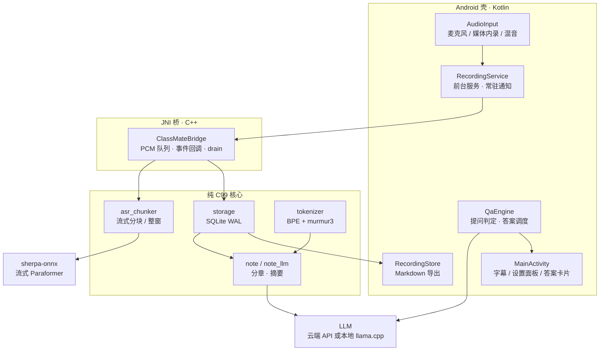

# ClassMate

**端侧课堂助手 · On-device classroom assistant for Android**

[](#安装)
[](#技术架构)
[](#技术架构)
[](LICENSE)
[](#开发进度)

把手机放在课桌上，它把老师讲的话实时变成字幕，课后自动整理成带章节的笔记；
当老师说「请一位同学来回答」时，1～2 秒内给出三条可以照着念的要点。

录音、语音识别、断句全在手机本地完成，只有**文字片段**会发给你自己配置的大模型接口。

> **English**: An Android app that turns live lectures into captions, chaptered notes and
> three-point answers to cold-call questions. Speech recognition runs fully on-device via
> sherpa-onnx; only short text snippets ever leave the phone, and only to the LLM endpoint
> you configure yourself.

---

## 为什么做这个

大学课堂上真正让人紧张的不是听不懂，而是**被点到名的那一刻**——脑子里有话，嘴上组织不出来。
同时，一节课 90 分钟的信息密度远超手写笔记的速度，课后复习往往只剩几张残缺的纸。

已有方案各有缺口：

| 现有方案 | 缺口 |
| --- | --- |
| 录音笔 / 手机录音 | 只有音频，复习时要重听一遍 |
| 云转写服务 | 按分钟计费，课堂音频要上传，隐私与网络都是问题 |
| 通用笔记 App | 要手动输入，跟不上讲课速度 |
| 实时字幕 App | 只出字幕，不解决「被提问」和「课后整理」 |

ClassMate 把三件事串成一条链：**听懂 → 提醒 → 整理**，并把最重的语音识别放在端侧。

---

## 功能

| 能力 | 实现方式 |
| --- | --- |
| 实时字幕 | sherpa-onnx 流式 Paraformer 中英双语，端侧推理，断网可用 |
| 三种音频来源 | ① 线下声音（麦克风）② 媒体音频（内录网课 / 线上会议）③ 两者混合 |
| 点名式提问识别 | 本地词表 + 规则判定，纯离线，不消耗 token |
| 三条答题要点 | 命中后发送「提问 + 前 80 字上文 + 课堂名」，返回 3 条短答案，振动 + 通知 + 卡片 |
| 课堂笔记 | 课后语义分章 + 摘要，一键导出 Markdown |
| 课后二次校正 | 可选 SenseVoice 模型整段重识别，修正流式识别的错字 |
| 音频留存策略 | 默认「临时」：处理完即删；也可选不存 / 长期保留 |
| 本地大模型 | llama.cpp + Qwen2.5-1.5B GGUF，完全离线的答题路径（可选） |

---

## 技术架构

设计原则是「**厚 C 核心 + 薄 Android 壳**」：识别分块、存储、分词、笔记生成都在纯 C99 里，
Android 层只负责音频采集、UI 和网络。核心可整块移植到桌面或 iOS。



### 几个关键设计

**统一的 16 kHz / 单声道 / PCM16 管道。** 麦克风、媒体内录、两者混音，最终都走同一个
`AudioInput` 帧输出。48 kHz 内录回退时用三点平均降采样，以麦克风为主时钟，混音走 3 秒环形缓冲。
上层对来源完全无感知，所以「内录的字幕与提问识别和线下完全一样」不需要写第二套逻辑。

**先落库再派发。** 核心的 `ca_core_emit` 先把 FINAL 句写进 SQLite 再回调 Kotlin，
界面崩了、进程被杀了，字幕和笔记都不丢。

**笔记读三级文本。** `text_refined > text_corrected > text`，课后二次校正与增量纠错的结果
会自动覆盖原始识别文本，导出时永远拿最新一版。

**会中增量只管纠错，出稿统一走语义分章。** 早期版本让增量摘要直接定稿，结果只有 2 章且摘要重复；
改为「增量负责实时纠错与会中进度，最终出稿一次性语义分章」后，同一堂课稳定产出 11 章、摘要互不重复。

**分词器哈希换 murmur3 finalizer。** 原始实现用 `key ^ (key >> 32)` 做 pair 哈希，只有 17 位熵，
15 万条 merges 全部挤成链表，停录出稿要 **82 秒**；换成 murmur3 finalizer 后合并耗时 165 ms，
出稿 **1.16 秒**。

---

## 安装

到 [Releases](../../releases) 下载 `ClassMate-0.7.0-M4-arm64.apk`，允许「安装未知来源应用」。

**要求**：Android 8.0+ / arm64 处理器。
底层 `sherpa-onnx`、`onnxruntime` 的预编译库只提供 arm64，32 位机器与 x86 模拟器无法运行。

### 首次使用三步

1. **给权限**：麦克风 + 通知。
2. **下模型**：设置 →「下载识别模型」，约 **237 MB**，走 `hf-mirror` 国内镜像，需联网。
3. **配 AI（可选）**：设置 →「云端设置」，填 `base_url` / `model_id` / `api_key`。
   不配也能用，但没有答题要点和像样的笔记。

---

## 从源码构建

| 依赖 | 版本 |
| --- | --- |
| JDK | 17 |
| Android SDK | Platform 34 / Build-Tools 34.0.0 |
| NDK | 26.1.10909125 |
| CMake | 3.22.1 |
| Gradle | 8.7（wrapper 自带） |

```bash
git clone https://github.com/<your-name>/classmate.git
cd classmate

# 指向你自己的 SDK（该文件已被 .gitignore，不会提交）
echo "sdk.dir=/path/to/Android/Sdk" > local.properties

./gradlew assembleDebug      # android/app/build/outputs/apk/debug/app-debug.apk
./gradlew assembleRelease    # android/app/build/outputs/apk/release/app-release.apk
```

Windows 下执行 `gradlew.bat assembleDebug`，或用 `install.bat` 直接装机。

> **遇到 `PKIX path building failed`**：说明在企业代理后面，Java 不信任代理 CA。
> 不要改仓库里的 `gradle.properties`（会破坏别人的构建），而是放到
> `<GRADLE_USER_HOME>/gradle.properties`：
> ```properties
> org.gradle.jvmargs=-Xmx2048m -Dfile.encoding=UTF-8 -Djavax.net.ssl.trustStoreType=WINDOWS-ROOT
> ```

### 关于签名

`android/app/keystore/classmate-release.jks` 是**故意公开**的开发签名
（alias `classmate`，密码 `classmate-dev`，有效期 10000 天）。

- 作用只有一个：让 Release 里的 APK 能被普通手机安装（未签名 APK 装不上）。
- 它**不代表任何官方身份**。正式发布请换成自己的 keystore，并同步修改
  `android/app/build.gradle.kts` 的 `signingConfigs`。
- 换签名后必须卸载旧版才能安装新版（Android 的签名一致性校验）。

---

## 模型与配置

模型不打进 APK，运行时按 `models/manifest.json` 下载到应用私有目录，带 sha256 校验与断点续传。

| 模型 | 用途 | 体积 | 来源 |
| --- | --- | --- | --- |
| Paraformer-bilingual-zh-en int8 | 流式识别（必需） | ~237 MB | [sherpa-onnx](https://github.com/k2-fsa/sherpa-onnx/releases) |
| Silero VAD | 断句（必需） | 0.6 MB | 同上 |
| SenseVoice int8 | 课后二次校正（可选） | ~239 MB | 同上 |
| Qwen2.5-1.5B-Instruct Q4_K_M | 本地 LLM（可选） | 1.1 GB | [Qwen GGUF](https://www.modelscope.cn/models/Qwen/Qwen2.5-1.5B-Instruct-GGUF) |

默认走 `hf-mirror.com`，失败回退 `huggingface.co`，都可以在 `models/manifest.json` 里改。

日常调参不需要碰 C 代码，改这几个文件后重新编译即可：

| 文件 | 内容 |
| --- | --- |
| `assets/qa_triggers.json` | 点名套话词表（触发词、排除词、动作词） |
| `assets/llm_config.json` | 上下文长度、超时、`max_tokens`、禁用思考开关 |
| `assets/prompts/` | 分章、摘要、三点答案的提示词 |

> 这两个 JSON 带 `version` 字段，App 会优先读设备上已保存的旧副本。
> 改完记得把 `version` 加 1，否则设备端不更新。

---

## 目录结构

```
classmate/
├── core/                 纯 C99：WAV、ASR 分块、SQLite、笔记、分词、本地 LLM
│   ├── include/classmate.h   对外 C ABI
│   ├── src/                  实现
│   └── tests/                桌面单元测试（WAV / 分块 / 存储 / 笔记）
├── platform/             JNI 桥（C++）：ASR 工作线程、有界队列、事件回调
├── android/app/          Android 壳（Kotlin）
│   ├── src/main/assets/      llm_config.json、qa_triggers.json、prompts/、replay/
│   ├── src/main/jniLibs/     预编译 sherpa-onnx / onnxruntime
│   └── keystore/             公开开发签名
├── models/manifest.json  模型下载清单（不含权重）
├── third_party/          llama.cpp、whisper.cpp、sherpa-onnx 头文件、SQLite amalgamation
└── docs/                 各里程碑实现说明（M3.4 / M3.5 / M4）
```

---

## 已知限制

1. **只支持 arm64-v8a**，sherpa-onnx / onnxruntime 仅提供该架构的预编译库。
2. **媒体内录每次都需要人工授权**。Android 不允许应用自行获取 MediaProjection，
   且必须先启动前台服务。这是系统限制，无法绕过。
3. **微信语音、电话类音频录不到**（`USAGE_VOICE_COMMUNICATION`，系统禁止采集）。
4. **没有云端 API 就没有答题要点**。判定是本地纯离线的，生成答案必须靠模型。
   本地 Qwen1.5B 代码路径可用，但未在中低端机上验证速度，默认不推荐。
5. **ASR 会出错字**，人名与专业术语尤其明显。课后二次校正能改善一部分，不能保证。
6. **长句中的「回答」类提问可能漏判**。规则做了大量排除词，宁可少报也不误报。
7. **UI 偏工程化**：设置面板折叠、答案卡片可拖动改高度，但整体交互未精修。
8. **无 iOS 版，无后端服务**。App 直连用户自己配置的 LLM 接口。
9. **媒体内录链路尚未完成端到端验证**：代码路径与权限流程已就绪，但系统授权框必须由人点按，
   尚未在第二台设备上走完整流程。

---

## 隐私与合规

- **音频不出设备**。识别在本地完成，模型文件也只在本地。
- 发送到 LLM 的只有文本：提问句 + 默认 80 字上文 + 课堂名。
- 音频默认「临时」策略，处理完即删；可选「不存」或「长期保留」。
- API Key 用 Android Keystore 加密后存应用私有目录，不写日志、不进配置文件、不入库。
- ⚠️ **录音前请确认所在学校、单位的规定并取得必要同意。** 课堂录音在许多地区受法律与校规约束。
  本项目只提供工具，不对使用方式负责。

---

## 开发进度

- [x] **M0** 骨架：C 核心 + JNI + Kotlin 壳，能录 WAV
- [x] **M1** 实时字幕（sherpa-onnx 流式 + VAD 切句）
- [x] **M2** SQLite 落库 + 模型管理（断点续传 / sha256）
- [x] **M3** 提问识别 + 云端答案 + 振动通知
- [x] **M3.4** 媒体内录 / 三档音频来源 / 答案开关
- [x] **M3.5** 设置面板折叠 / 答案卡片可拖动
- [x] **M4** 课堂笔记 + 语义分章 + Markdown 导出
- [ ] **M5** 长时稳定性、内存与耗电优化、本地模型实测

---

## 贡献

欢迎 issue 与 PR。提问题前请先确认不在「已知限制」内。

```bash
./gradlew :app:runQaCorpus     # 点名判定语料回归
./gradlew :app:assembleDebug   # 编译
```

`core/` 可以在电脑上单独跑单元测试（不依赖 Android）：

```bash
cmake -S . -B build && cmake --build build && ctest --test-dir build
```

---

## 第三方组件

见 [THIRD_PARTY_NOTICES.md](THIRD_PARTY_NOTICES.md)。本项目代码以 [MIT](LICENSE) 协议开源。

## 免责声明

个人学习性质的开源项目，与任何模型提供方、高校或组织无隶属关系，也未获得其背书。
